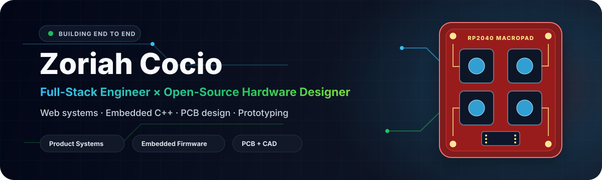

  

  
  
  
  

## Full-stack software engineering meets physical hardware

I am a **Full-Stack Software Engineer and Open-Source Hardware Designer** building complete systems—from high-performance web applications and reusable UI foundations to custom PCBs, embedded C++ firmware, and working physical prototypes.

My work does not stop at the browser or the breadboard. I care about the entire path: product architecture, interface performance, device firmware, electrical design, mechanical constraints, manufacturing files, automation, testing, and clear documentation.

<table>
  <tr>
    <td><strong>Core focus</strong></td>
    <td>Full-stack engineering, hardware prototyping, PCB design, embedded firmware, and physical product development</td>
  </tr>
  <tr>
    <td><strong>Software systems</strong></td>
    <td>Product architecture, design systems, analytics interfaces, real-time UX, automation, and developer tooling</td>
  </tr>
  <tr>
    <td><strong>Hardware systems</strong></td>
    <td>Custom PCBs, USB devices, embedded C++, switch matrices, electrical prototyping, and CAD-aware design</td>
  </tr>
</table>

## Hardware & Embedded Systems

### RP2040 Custom 2×2 USB Macropad

  

I engineered [`rp2040-macropad`](https://github.com/codejupiter/rp2040-macropad) from scratch: a compact, open-hardware USB input device built around a header-mounted Raspberry Pi Pico. The **58 × 97 mm, two-layer PCB** was designed and routed in **KiCad**, ordered with a **red solder mask**, and carries four MX-compatible switches with one **1N4148 diode per key** for an anti-ghosting 2×2 matrix.

The firmware is written in **C++17** on the official **Raspberry Pi Pico SDK** and uses **TinyUSB** for driverless USB HID keyboard reports. The repository includes editable KiCad sources, verified Gerber and drill files, a bill of materials, assembly documentation, automated CMake builds, and a `picotool`/BOOTSEL flashing workflow.

  <a href="https://github.com/codejupiter/rp2040-macropad"><strong>Explore the repository</strong></a>
  &nbsp;·&nbsp;
  <a href="https://github.com/codejupiter/rp2040-macropad/tree/main/hardware"><strong>KiCad & manufacturing files</strong></a>
  &nbsp;·&nbsp;
  <a href="https://github.com/codejupiter/rp2040-macropad/blob/main/main.cpp"><strong>Firmware</strong></a>

| Hardware | Firmware | Delivery |
| --- | --- | --- |
| Raspberry Pi Pico / RP2040 | C++17 + Pico SDK | CMake + GitHub Actions |
| 2×2 MX switch matrix | TinyUSB HID keyboard | Automated flashing script |
| Four 1N4148 diodes | Debouncing + multi-key input | Gerber, drill, BOM, and assembly docs |
| 58 × 97 mm, two-layer PCB | GP0/GP1 rows · GP6/GP7 columns | Zero-dependency host integration |

## Full-stack software ecosystem

<table>
  <tr>
    <td width="33%" valign="top">
      <h3><a href="https://github.com/codejupiter/Dense-UI">Dense-UI</a></h3>
      
A compact, accessible React component library for data-heavy dashboards, admin panels, and operational tools. Built with TypeScript, Radix primitives, CSS variables, Storybook, and tree-shakeable package exports.

      
<a href="https://dense-ui.vercel.app"><strong>Live documentation →</strong></a>

    </td>
    <td width="33%" valign="top">
      <h3><a href="https://github.com/codejupiter/Spendboard">SpendBoard</a></h3>
      
A high-performance spend analytics dashboard with filtering, charts, saved views, keyboard navigation, and a virtualized table handling 50,000+ transactions.

      
<a href="https://spendboard-beige.vercel.app"><strong>Live demo →</strong></a>

    </td>
    <td width="33%" valign="top">
      <h3><a href="https://github.com/codejupiter/dealbrief">dealbrief</a></h3>
      
An agentic deal-intelligence application with a five-stage LLM pipeline, streaming synthesis, embedding-based playbook matching, and structured model handoffs.

      
<a href="https://dealbrief-codejupiters-projects.vercel.app"><strong>Live demo →</strong></a>

    </td>
  </tr>
</table>

Across these projects I build the product surface and the systems behind it: typed application architecture, reusable UI primitives, large-data rendering, AI-assisted workflows, test suites, CI pipelines, deployment automation, and production-focused documentation.

## Engineering stack

### Frontend & product UI

  
  
  
  
  

### Backend & automation

  
  
  
  
  

### Embedded & hardware

  
  
  
  
  
  
  

## What I optimize for

- **End-to-end ownership** — from an interaction model or circuit sketch to a tested, documented release.
- **Performance with evidence** — virtualized data interfaces, measurable bundle decisions, and tight embedded loops.
- **Reproducibility** — automated builds, flashing, checks, and manufacturing outputs that another engineer can use.
- **Open engineering** — readable source, explicit tradeoffs, and documentation that makes the work easier to extend.

## GitHub activity

  
  

## Let’s build something complete

I am open to full-stack, frontend, product engineering, embedded systems, and cross-disciplinary hardware/software opportunities.

  <a href="https://zoriahcocio.com"><strong>Portfolio</strong></a>
  &nbsp;·&nbsp;
  <a href="https://linkedin.com/in/zoriah-cocio"><strong>LinkedIn</strong></a>
  &nbsp;·&nbsp;
  <a href="mailto:info@zoriahcocio.com"><strong>Email</strong></a>

